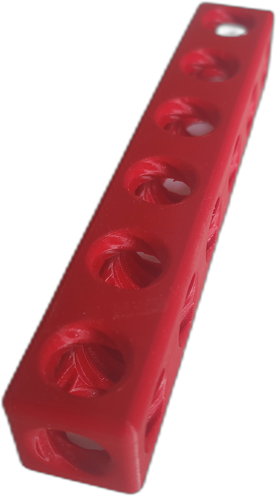

# SpiroBrixx-Baukastensystem

[](https://github.com/TheTesla/SpiroBrixx/actions/workflows/reuse.yml)
[](LICENSE)

*English version: [README.md](README.md)*


Die _SpiroBrixx_-Bausteine ermöglichen Makern, Wissenschaftlern und Künstlern, ihre mechanischen Konstruktionen und Laborprojekte in Minuten zu prototypisieren.

_Quaderförmige Blöcke mit viergängigen Innengewinden, parallel zu allen drei Raumachsen, werden im 90°-Raster abstandsfrei zusammengeschraubt. Da beide verbundenen Teile Innengewinde tragen, ist die Verbindung formschlüssig statt kraftschlüssig — sie nimmt hohe Zugkräfte auf und lässt sich zerstörungsfrei mit einem Schraubendreher wieder lösen, ohne Schneidwerkzeug, ohne Spezialwerkzeug._ Eine ausführliche Beschreibung der Motivation und Entwurfsgründe steht im [Konzeptdokument](doc/src/SpiroBrixxKonzept.md).



## Voraussetzungen

* [Poetry](https://python-poetry.org/) (Abhängigkeitsverwaltung)
* Python 3.11+

## Bauen und Erzeugen

Einfach ausführen:

```bash
./build.sh
```

Dies installiert die Python-Abhängigkeiten und erzeugt die 3D-druckbaren STL- (oder OBJ-)Dateien in `gen/mech/spirobrixx/`. Der Satz erzeugter Teile und das verwendete Profil werden in `src/mech/spirobrixx/make.py` konfiguriert. Alle erzeugten Dateien entfernen mit:

```bash
./clean.sh
```

## Drucken

Empfohlene Druckparameter:

* Material: PETG
* Material mindestens 24 h vor dem Drucken trocknen.
* Düse: 0,4 mm
* Innenkontur: 0,8 mm
* Füllung: 0,8 mm
* Standardwerte für alle übrigen Parameter
* Kurzes Heißwasser-Anlassen (Annealing) nach dem Drucken: Bauteil für wenige Minuten in heißes Wasser (kurz unter dem Siedepunkt) tauchen, dann langsam abkühlen lassen. Baut innere Druckspannungen ab.

## Lizenz

SpiroBrixx ist lizenziert unter der **CERN Open Hardware Licence Version 2 - Strongly Reciprocal (CERN-OHL-S-2.0)** — siehe [LICENSE](LICENSE) und [LICENSES/CERN-OHL-S-2.0.txt](LICENSES/CERN-OHL-S-2.0.txt).

This source describes Open Hardware and is licensed under the CERN-OHL-S v2.
You may redistribute and modify this source and make products using it under
the terms of the CERN-OHL-S v2. This source is distributed WITHOUT ANY EXPRESS
OR IMPLIED WARRANTY, INCLUDING OF MERCHANTABILITY, SATISFACTORY QUALITY AND
FITNESS FOR A PARTICULAR PURPOSE. Please see the CERN-OHL-S v2 for applicable
conditions.
